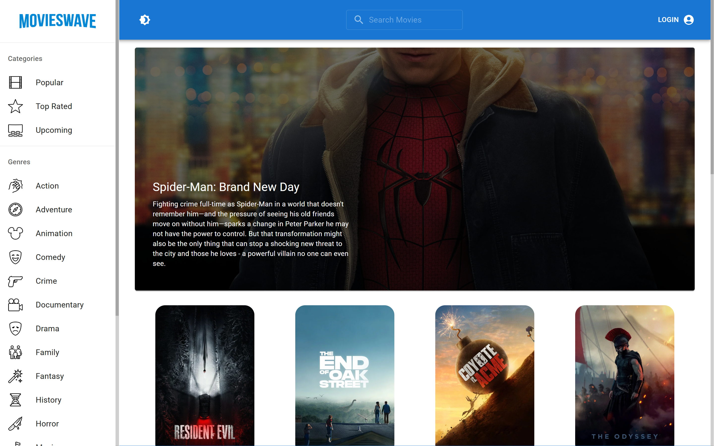
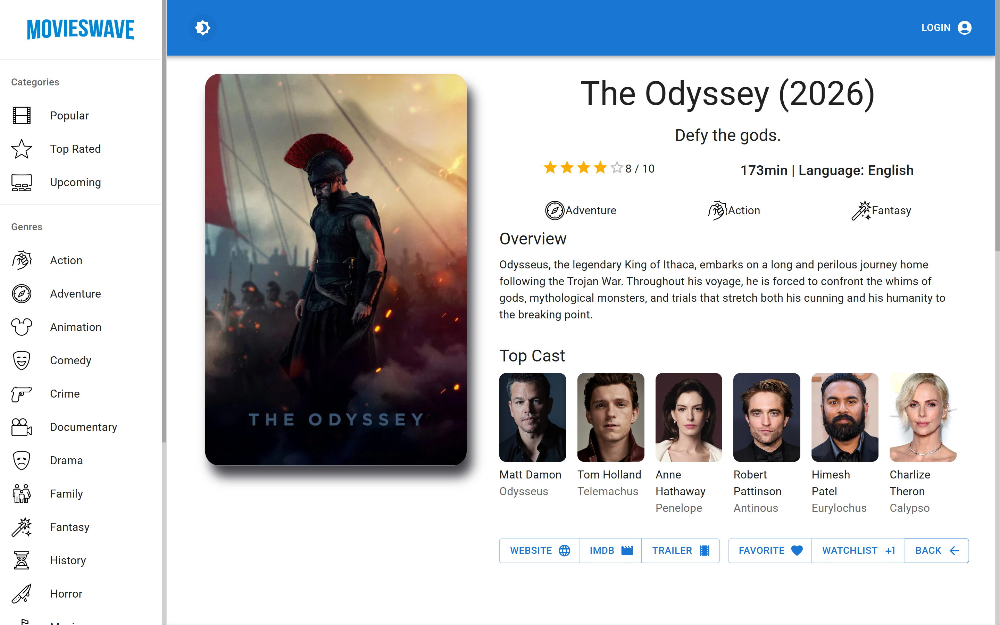

# MoviesWave


**[Live](https://movieswave.netlify.app)**

A film browser over [The Movie Database (TMDb)](https://www.themoviedb.org/) API: browse by
category or genre, search, open a film for its cast, trailer and recommendations, follow an actor
to their other films, and keep a favourites list and a watchlist on a TMDb account. Light and dark
themes.



## What it does that a plain fetch would not

Every TMDb call goes through one **RTK Query** API slice (`src/services/TMDB.js`), so a page
already loaded comes back from the Redux cache rather than the network. Going back and forth
between categories and films in a normal browsing session made about half as many TMDb calls as
before, measured by comparing the browser's network panel with and without the cache.



## Running it

Needs a TMDb API key (free, from your TMDb account settings).

```sh
npm install
echo "VITE_TMDB_KEY=<your key>" > .env
npm run dev
```

Deployed on Netlify; `netlify.toml` sends every path to `index.html` so client-side routes load on
refresh.

## Stack

React 17 · Redux Toolkit and RTK Query · React Router 6 · Material UI 5 · Axios · Vite
